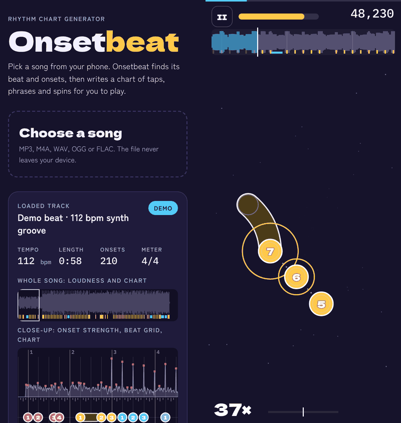

# Onsetbeat

**Play it: [nrbernier.github.io/onsetbeat](https://nrbernier.github.io/onsetbeat/)**. On a phone, add it to the home screen; it then works offline.



A mobile rhythm game in the spirit of [Osu! Tatakae! Ouendan](https://en.wikipedia.org/wiki/Osu!_Tatakae!_Ouendan) (Nintendo DS, 2005), played on charts generated from your own music. To see what the original plays like, watch this [gameplay video](https://archive.org/details/LP_Ouendan1/ouendan1_02.avi) (Internet Archive, no ads).

Pick an audio file and Onsetbeat analyses it entirely in the browser:

1. **Onsets**: spectral flux over ~40 mel bands, with adaptive peak picking.
2. **Tempo**: autocorrelation of the onset novelty in 8 s windows, joined by a Viterbi path, so the tempo can change mid-song without flickering or jumping octaves.
3. **Beats**: dynamic-programming beat tracking (Ellis 2007) using the local tempo at each moment.
4. **Feel**: each beat is split into four (straight) or three (triplet/swing), whichever fits the off-beat onsets.
5. **Meter**: per section, the bar length (3, 4, 5 or 7 beats) that makes the beat patterns repeat; the downbeat is the bar position with the most kick energy.
6. **Chart**: onsets are snapped to the grid and the strongest are kept per difficulty (Easy: beats only … Insane: sixteenths).
7. **Markers**: sustained sound after a note becomes a **phrase** (slider, sometimes with reverses), a long loud stretch without hits becomes a **spin**, everything else is a **tap**.
8. **Layout**: each bar is drawn as one shape whose turns come from the rhythm and from what starts each note (kick, snare or hat), so a repeated rhythm draws the same shape again. Nothing overlaps anything still on screen, and dotted follow lines lead from one marker to the next.

If the beat comes out twice too fast or too slow, or the bars start on the wrong beat, the **Beat fix** buttons (×2, ÷2, move the bar start) correct it; the fix is saved with the song.

Pausing and resuming replays the last two seconds with a count-down.

Long songs can be cut to 1, 1:30 or 2 minutes for a playthrough; the cut starts and ends on a bar line and the music fades out at the end.

How each step works, with illustrations: [docs/analysis.md](docs/analysis.md).

The close-up view shows onset strength, the beat grid and the generated chart, and "Hear the chart" plays the song with a click on every marker.

The analysis runs on a mono 11 kHz copy of the song and is saved on the device, so a song opens instantly the next time. Playback always streams the original file at full quality.

No build step and no dependencies: `index.html` is the whole app, so it runs as is on GitHub Pages. `sw.js` keeps it (with the fonts in `fonts/`) on the device for offline use. Audio files never leave the device.

## Tests

```
node --test tests/*.test.js
```

The tests run the real analysis and chart code from `index.html` on synthetic drum tracks with a known tempo, meter and swing (`tests/synth.js`), and check the charts for density, phrase speed and overlap. They run on every push (GitHub Actions). `node docs/tools/make-figures.js` redraws the figures in the docs from the same code.

## Licence

Code: [MIT](LICENSE). Fonts in `fonts/`: SIL Open Font License 1.1 (licence texts alongside).
