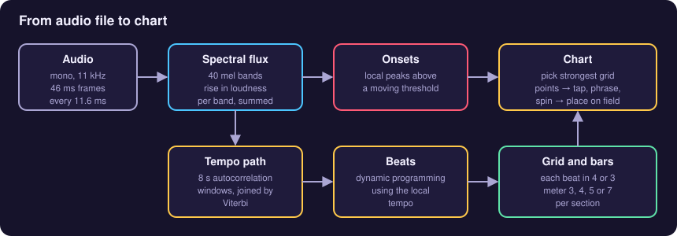
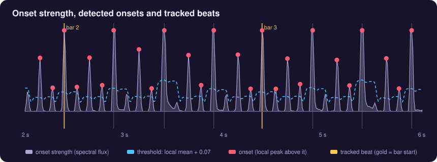
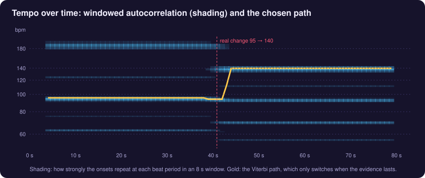
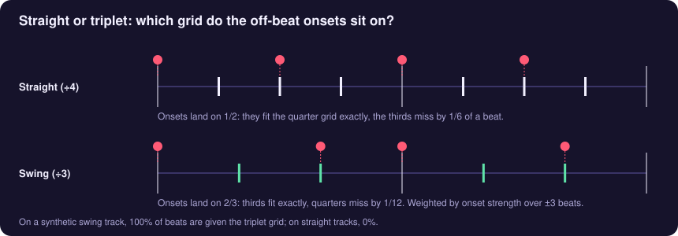
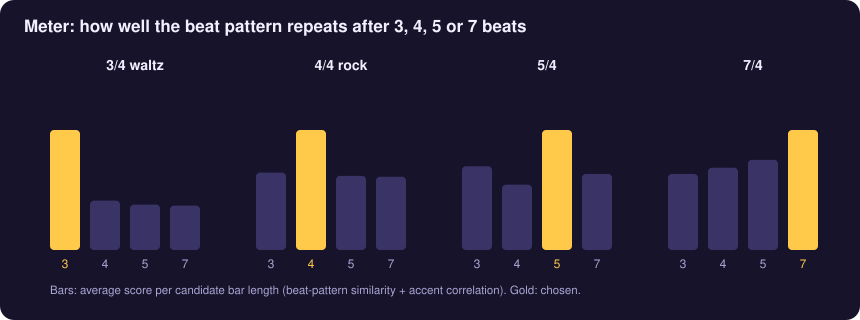
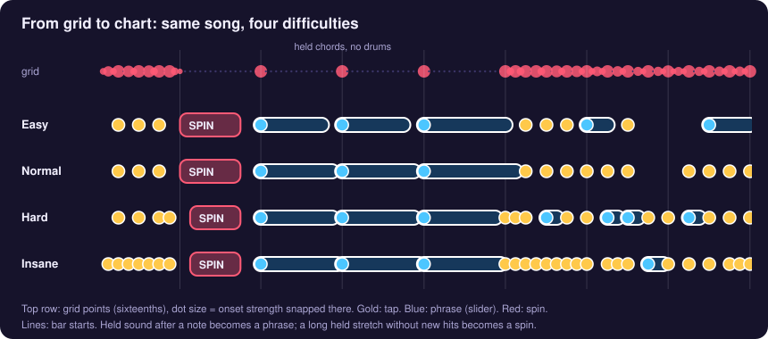
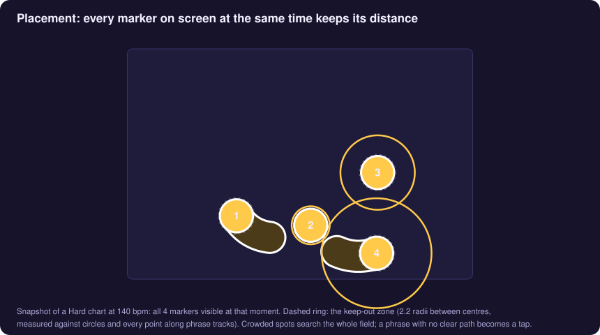

# How Onsetbeat analyses music

Onsetbeat turns any audio file into a playable chart. Everything runs in the browser: the analysis in a Web Worker, the chart generation on the page. This note explains each step, with the actual parameter values from `index.html`.

All illustrations are produced by the real analysis code, run on synthetic test tracks (drum patterns generated with known tempo, meter and swing). That way the right answer is known and the pictures show what the code really does.

---

## 1. Preparing the audio

- The file is decoded by the browser (`decodeAudioData`), so any format the browser plays works: MP3, AAC/M4A, WAV, OGG, FLAC.
- The analysis uses a **mono, 11.025 kHz** copy. Onsets and beats live well below 5 kHz, and on the test tracks this gives the same results as 22 kHz. It also takes a quarter of the memory and runs twice as fast.
- The audio is cut into **512-sample frames (46 ms) every 128 samples (11.6 ms)**, each with a Hann window. That gives about 86 analysis frames per second.

**Playback is separate from the analysis.** Songs up to 8 minutes are decoded at full quality for playback. Longer songs play the original file, streamed through an `<audio>` element, so a 23-minute track never has to sit decoded in memory.

## 2. Onsets: when does something new start?

For every frame, the spectrum is grouped into **40 mel-spaced bands** (35 Hz up to half the sample rate), and the log of the average magnitude is taken in each band. The **spectral flux** is the sum, over all bands, of how much each band got louder since the previous frame (decreases are ignored).

Mel bands matter here. With raw FFT bins, most bins sit above 3 kHz, so hi-hats and cymbals swamped the kick drum, and the beat tracker locked onto the off-beats. With 40 bands, the low end gets a fair share.

The flux is smoothed, then normalised so its 95th percentile is 1. An **onset** is a frame that:

- is the highest value within ±3 frames (±35 ms),
- is above **the local mean (−140 ms … +80 ms) + 0.07**,
- is above 0.08 overall,
- and is at least 46 ms after the previous onset. If two onsets are closer than that, the stronger one is kept.

Two extra flux curves are kept, for the low band (below 180 Hz, kicks and bass) and the high band (above 3 kHz, hats and snares). They are used later for the downbeat and the meter.

## 3. Tempo, allowed to change

A single tempo for the whole song breaks on tracks that speed up or have a new section. So the tempo is estimated **locally**:

1. A *novelty* curve is the flux minus its local mean (±190 ms), floored at zero.
2. In **8-second windows, every 1 second**, the novelty is autocorrelated for every beat period between 50 and 210 bpm. A period scores its own correlation plus half the correlation at twice the period, which favours the beat over its subdivisions. A gentle preference centred on 115 bpm discourages half- and double-tempo answers.
3. A **Viterbi path** picks one period per window. Changing tempo costs `8 × (log₂ of the ratio)²`. Small drifts are almost free; a jump from 95 to 140 bpm only happens if the new tempo keeps winning for several seconds. This stops flicker and octave errors.

The shading in the figure shows the competing candidates: the true tempo, its half and double, and some in-between multiples. The path stays on 95 bpm, then moves to 140 bpm a couple of seconds after the real change, once the 8-second windows have filled with the new tempo.

## 4. Beats by dynamic programming

Beats are placed with the classic method by Ellis (2007), adapted to the local tempo:

- Each frame gets a score: the novelty, lightly smoothed.
- For each frame `t`, the best previous beat is searched between half and twice the local period `P(t)`. Each candidate costs `100 × (log(gap / P(t)))²`, so gaps close to the expected period are cheap.
- The best chain is traced back from the end, which yields beats that sit on onsets where there are onsets and keep a steady pulse where there are none.

Skipped beats are filled in, and the grid is extended to the start and end of the song, so quiet intros and outros still have beats.

## 5. Straight or swung?

Each beat is split into a grid of either **4 sixteenths** (straight) or **3 triplet eighths** (swing, shuffle, 6/8 feel). For the onsets inside a beat, the code measures how far each one sits from the nearest quarter position and from the nearest third, weighted by onset strength. Summed over ±3 beats, if the thirds fit clearly better, that beat gets the triplet grid.

## 6. Meter, per section

Bars matter for the chart. The first beat of a bar gets priority, and combo numbers restart each bar. Onsetbeat tests bar lengths of **3, 4, 5 and 7 beats**:

- Each beat gets a fingerprint: low, full and high-band flux at its four quarter positions (12 numbers, normalised).
- For each candidate length `m`, around every beat (±12 beats), the code averages how similar each beat's fingerprint is to the one `m` beats later. It adds half the correlation of the kick accents at that distance. 4 gets a small head start, 7 a small penalty.
- A Viterbi pass over the beats picks one meter per beat, with a cost of 2.5 for switching, so the meter only changes when a section really is different.
- In each section, the **downbeat** is the bar position with the most kick energy on average.

On the test tracks this detects 3/4, 4/4, 5/4 and 7/4 correctly, and finds both changes in a 4/4 → 5/4 → 4/4 track to within a bar.

**Known limit:** in 5/4 with kicks on both 1 and 4, the bar start is ambiguous and sometimes lands on 4. Uneven meters like 9/8 (2+2+2+3) are not detected. The beats there are evenly spaced, so the bar lines are only approximate.

## 7. From grid to chart

Every grid point collects the strongest onset that snaps to it. Each grid point then gets a **score**: its strength divided by the strongest onset within ±8 beats, so quiet passages still get notes. That is multiplied by a metric weight: downbeat 1.3, beat 1.1, eighth/triplet 0.85, sixteenth 0.6.

Points are taken from the highest score down, until a per-difficulty target is reached:

| Difficulty | Grid used | Min. spacing | Target density |
|---|---|---|---|
| Easy | beats only | ~1 beat | 0.5 per beat, max 1.2/s |
| Normal | + eighths/triplets | ~⅓ beat | 0.8 per beat, max 2.1/s |
| Hard | + sixteenths | ~⅓ beat | 1.1 per beat, max 3.0/s |
| Insane | + sixteenths | ~⅙ beat | 1.55 per beat, max 4.4/s |

Each picked note then becomes a marker, depending on what happens until the next note:

- **Spin**: a gap of at least 6 beats, or 4 if the sound is held, while the music stays loud. At most one spin every 14 s. The spin runs from one beat after the note to one beat before the next.
- **Phrase** (slider): the sound after the note stays at least half as loud as its attack, with little new onset activity. Some longer gaps also become phrases at random, for variety. A phrase ends a short release before the next note. When its length divides evenly on the grid, it may turn back 1–3 times.
- **Tap**: everything else.

The randomness is seeded from the song name and length, so the same song always gives the same chart.

## 8. Placing markers on the screen

Positions follow the timing: the distance from one marker to the next grows with the time between them (0.30–0.40 screen units per beat, depending on difficulty). The direction drifts, with an occasional sharp turn.

**No overlap:** a new marker must keep **2.2 radii** between its centre and everything still visible when it appears. That means every earlier circle and every point along earlier phrase tracks.

- The search tries 24 directions at four distances, then 160 random spots anywhere on the field.
- A phrase tries 24 directions at three lengths.
- If a phrase still can't fit, it is turned into a plain tap rather than overlap.

Across 15,000 checked pairs of markers that share the screen, none overlap.

## 9. Timing during play

- **Decoded songs:** the song clock is the Web Audio clock, refined with `getOutputTimestamp()` and corrected for the device's output latency.
- **Streamed long songs:** the clock follows the `<audio>` element's time, smoothed against `performance.now()`. The lead-in before the first marker comes from a Web Audio delay line.
- Taps are judged on the event's own timestamp, not the next animation frame. The windows are ±42–65 ms for 300, ±85–120 ms for 100 and ±125–180 ms for 50, depending on difficulty.
- After each song, the median tap error is shown, and the timing offset can be set from it. This calibrates Bluetooth and other latency.

## References

- D. P. W. Ellis, *Beat Tracking by Dynamic Programming*, Journal of New Music Research, 2007.
- S. Böck, F. Krebs, M. Schedl, *Evaluating the Online Capabilities of Onset Detection Methods*, ISMIR 2012 (spectral flux on log-filtered spectra).
